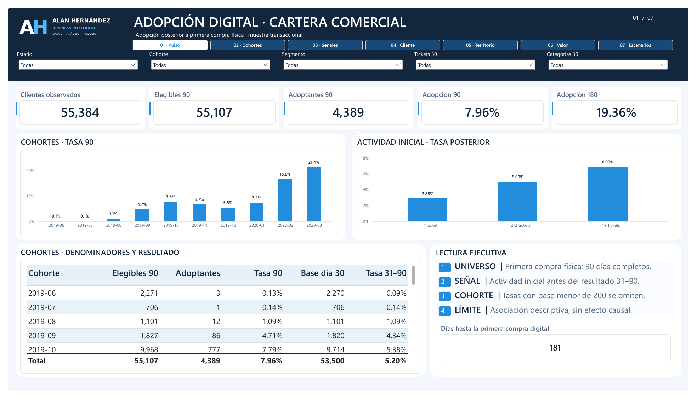

# AH | Adopción digital y analítica comercial

**Alan Arturo Hernández Gutiérrez** · Business Intelligence · Python, Jupyter y Power BI

> **Pregunta de negocio:** ¿qué clientes con una primera compra física observada realizan después una compra por Internet, y qué comportamientos y condiciones de calidad conviene revisar antes de priorizar acciones comerciales?

## Resumen

El caso organiza una muestra transaccional de comercio minorista en un modelo dimensional. La unidad de movimiento es la línea ticket–producto; la unidad de análisis de adopción es cliente–corte–regla. Esta separación evita contar líneas o cuentas como clientes y permite comparar cohortes con el mismo tiempo de seguimiento.

El flujo contiene exploración de siete tablas, reglas de limpieza y enriquecimiento, dos hechos, siete dimensiones y controles de integridad. Seis tablas se importan desde CSV; `DimFecha`, `DimCorte` y `DimTiendaPreferida` se calculan en Power BI a partir de ellas. El modelo incorpora canal, categoría, tienda, municipio, calendario, primera actividad observada, recurrencia y cuatro reglas de sensibilidad. El contexto municipal de acceso a Internet procede del ITER 2020 oficial y se une por clave de municipio.

## Datos y alcance

La muestra cubre movimientos del **1 de junio de 2019 al 31 de mayo de 2021**. La primera compra registrada representa la primera **observada en esa ventana**. El conjunto público de muestra contiene siete tablas de comercio minorista utilizadas en un ejercicio técnico. La [ficha de datos](data/README.md) identifica el archivo, su granularidad y las condiciones de acceso.

Los importes conservan el signo de origen. La moneda, la naturaleza de importes negativos y el significado comercial de los servicios requieren confirmación de la fuente. Las cuatro reglas del análisis muestran la sensibilidad de los resultados a esas decisiones. La tasa de adopción describe una secuencia observada de compras; los datos disponibles no miden exposición a campañas ni conversión de visitas web.

## Método y decisiones

1. **Comprender la fuente.** Perfilar las 26 variables, su granularidad, nulos, claves y cobertura entre tablas.
2. **Definir el universo.** Consolidar cuentas en clientes y separar empates de canal o canales desconocidos en el primer día observado.
3. **Comparar cohortes.** Calcular adopción a 30, 90 y 180 días solo cuando la ventana completa es observable; 90 días es la vista principal.
4. **Preparar el modelo.** Conservar movimientos a nivel de línea y producir un snapshot cliente–corte–regla, con dimensiones de fecha, cliente, producto, tienda, tienda preferida, regla y corte.
5. **Contrastar definiciones.** Comparar la base con escenarios de importes positivos y exclusión de servicios, sin convertir esas variantes en hechos empresariales confirmados.
6. **Validar.** Comprobar claves, duplicados, cobertura, filas, importes, denominadores y archivos exportados antes de usar el modelo en Power BI.

La [matriz de variables y decisiones](docs/matriz-variable-decision.md), el [modelo y linaje](docs/arquitectura-y-modelo.md), el [diccionario físico](docs/diccionario-modelo.md) y el [diccionario de KPI](docs/diccionario-kpi.md) documentan las reglas y su utilidad.

## Métricas que orientan el reporte

| Métrica | Definición | Decisión que apoya |
| --- | --- | --- |
| Clientes observados | Clientes distintos con al menos un movimiento hasta el corte | Dimensionar la cartera analizable |
| Elegibles a 90 días | Primera actividad física observada, sin ambigüedad de canal y con 90 días de seguimiento | Comparar grupos con una ventana equivalente |
| Adopción digital a 90 días | Elegibles con una compra por Internet posterior dentro de 90 días / elegibles a 90 días | Localizar cohortes y segmentos para investigar |
| Recurrencia a 90 días | Clientes con otra fecha de actividad dentro de 90 días / clientes con ventana completa | Describir continuidad de actividad |
| Concentración de importes positivos | Importe positivo del 10 % superior de clientes / importe positivo total | Identificar concentración comercial sin inferir rentabilidad |

Las definiciones, filtros, nulos y unidades se detallan en el [diccionario de KPI](docs/diccionario-kpi.md). Los resultados de referencia permiten conciliar los datos transformados con las medidas del reporte.

## Reporte Power BI

El PBIP contiene siete páginas: **Pulso**, **Cohortes**, **Señales**, **Cliente**, **Territorio**, **Valor** y **Escenarios**. Cada vista responde una pregunta de negocio descrita en [tablero y decisiones](docs/tablero-y-decisiones.md). Las tarjetas, gráficos y tablas usan [medidas numeradas](docs/diccionario-kpi.md). La vista de cliente–corte–regla permite contrastar tasa y volumen sin acumular las cuatro variantes del mismo cliente.

Los gráficos omiten tasas de segmentos con menos de 200 elegibles o candidatos. Las tablas muestran `n<200` junto al denominador. Los 5,621 clientes sin municipio de domicilio en la fuente aparecen como **Sin domicilio válido**; no se les asigna el estado de una tienda. El mapa de estados usa únicamente domicilios válidos y claves ISO del mapa de México.

## Resultados y decisiones

| Indicador de referencia | Resultado | Lectura |
| --- | ---: | --- |
| Líneas de movimiento | 1,337,800 | Detalle ticket–producto preservado por el ETL |
| Clientes observados | 55,384 | Clientes distintos con actividad |
| Elegibles a 90 días, regla base | 55,107 | Origen físico y seguimiento completo |
| Adoptantes a 90 días | 4,389 | Primera compra digital posterior dentro de 90 días |
| Adopción a 90 días | 7.96 % | 4,389 / 55,107 |
| Candidatos al día 30 | 53,500 | Elegibles sin compra digital en los primeros 30 días |
| Adopción entre días 31–90 | 5.20 % | 2,782 / 53,500 |

La frecuencia física inicial distingue grupos que merece la pena investigar: la tasa posterior es **2.88 %** con un ticket, **5.00 %** con dos o tres y **6.90 %** con cuatro o más. Un piloto puede estratificar estos grupos y comparar resultados con un control; la asociación observada no estima el efecto de contactar al cliente.

Las reglas de importes y servicios sitúan la adopción a 90 días entre **7.78 % y 8.92 %**. Esa sensibilidad justifica acordar primero qué operaciones entran al indicador, manteniendo cada variante con su denominador.

La cobertura de domicilio alcanza **89.85 %**, mientras que la edad está disponible para **8.72 %** de los clientes. La priorización territorial tiene mayor cobertura que una segmentación etaria; ambas deben mostrar población disponible y faltante. El contexto de Internet del municipio orienta una hipótesis territorial, sin asignar esa condición a una persona.

En el escenario inicial, alcanzar al 25 % de los 53,500 candidatos con una mejora supuesta de 2 puntos porcentuales produce **268 adoptantes y 536 tickets ilustrativos**. Son entradas de planeación editables; su utilidad es dimensionar el piloto.

[Preguntas y decisiones por página](docs/tablero-y-decisiones.md) · [Ver reporte PDF](reports/Caso_Adopcion_Digital.pdf)



## Estructura

```text
AH_Adopcion_Digital/
├── README.md
├── docs/             # Variables, reglas, KPI, linaje y reproducción
├── notebooks/        # Exploración, ETL y configuración de rutas de Power BI
├── src/              # Cuadernos auxiliares documentados y pruebas
├── catalogos/        # Catálogo estatal y registro de fuente oficial
├── config/           # Parámetros del caso
├── data/README.md    # Procedencia y acceso a la muestra
├── input/            # Muestra transaccional e ITER 2020
├── output/           # Seis CSV importados por Power BI
├── assets/           # Logo AH y captura real del reporte
├── powerbi/          # PBIP, reporte y modelo semántico
├── reports/          # PDF de siete páginas del reporte
└── evidencia/        # Controles generados al ejecutar los cuadernos; excluidos de Git
```

La entrega incluye las dos entradas ZIP, los seis CSV de consumo, el PBIP editable, el PDF y una captura real del reporte. Los controles detallados se regeneran en `evidencia/`; el mapa reversible de claves permanece fuera del paquete. El logo AH acompaña la documentación del caso. La [guía de reproducción](docs/guia-de-reproduccion.md) explica cómo preparar los seis CSV, configurar `pArchivo` y actualizar el PBIP. La caché local de Power BI tampoco forma parte de la entrega pública.

## Cómo reproducir en Windows

1. Extraiga la carpeta completa y conserve su estructura. El PDF puede consultarse directamente en `reports/`.
2. Inicie Jupyter desde la raíz del proyecto o desde `notebooks/`; compruebe su directorio de trabajo con `from pathlib import Path; print(Path.cwd())`.
3. Ejecute `01_exploracion.ipynb` y `02_etl.ipynb` para reproducir los resultados. Las entradas y los seis CSV de consumo también están incluidos.
4. Con Power BI Desktop cerrado, ejecute `03_Configurar_Rutas_PowerBI.ipynb` para adaptar `pArchivo` a su carpeta de `output/`.
5. Abra `powerbi/Caso_Adopcion_Digital.pbip`, actualice el modelo y contraste sus cifras con el PDF y la matriz de controles.

La [guía de reproducción](docs/guia-de-reproduccion.md) detalla requisitos, rutas, reejecución y diagnóstico.

## Calidad y límites

El código incluye pruebas de fronteras para fechas, empates, visitas, importes y totales municipales. El ETL vuelve a abrir los CSV producidos y compara estructura, filas y centavos. Consulte [validaciones y límites](docs/validaciones-y-limites.md) para conocer qué está acreditado por ejecución y qué requiere la comprobación en Desktop.

**AH · Simplicidad a través de la elegancia.**
