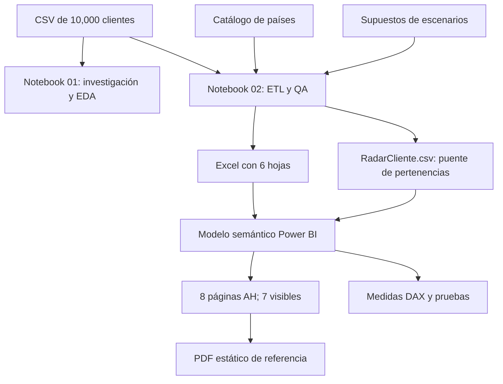

# Arquitectura técnica y linaje de información

## Flujo de extremo a extremo

## Contratos entre componentes
- **Entrada:** `input/Bank Customer Churn Prediction.csv` con las 12 columnas previstas, 10,000 filas y cliente único; `catalogos/DimPais.csv` y `catalogos/SupuestosEscenarios.json`.
- **Exploración:** notebook 01 analiza calidad, cortes por variable, cruces, reglas de hipótesis y radar antes de fijar transformaciones. No altera los datos de entrada.
- **Transformación:** notebook 02 conserva columnas fuente, genera 10 derivadas y tablas auxiliares, realiza aserciones y exporta el modelo.
- **Salida Excel:** `FactClientes`, `DimPais`, `RadarSegmentos`, `CalidadCliente`, `Escenarios`, `HipotesisResumen`.
- **Salida puente:** `RadarCliente.csv` contiene pares `segmento_id`–`customer_id` y permite resolver unicidad bajo selección múltiple.
- **Consumo:** `powerbi/Caso_Analitica_Clientes.pbip`, modelo TMDL, expresiones de origen Excel/CSV y páginas JSON de Power BI.
- **Visualización:** siete páginas visibles y una técnica oculta; `reports/` conserva el PDF de referencia.

## Justificación de separación
1. **Hecho cliente:** claves y características únicas, apto para contar personas.
2. **Dimensión geográfica:** atributos descriptivos de país.
3. **Radar reglas:** grupos y atributos analíticos, no una segunda población independiente.
4. **Radar membresías:** relación muchos-a-muchos conceptual; requiere medidas de unicidad.
5. **Calidad:** alertas asociadas a cliente, separadas de métricas de negocio.
6. **Escenarios:** entradas y resultados hipotéticos, separados de observaciones históricas.

## Parámetros y rutas portables
Los notebooks de análisis y ETL utilizan carpetas relativas a la raíz del proyecto. El notebook `03_Configurar_Rutas_PowerBI.ipynb` configura los parámetros de origen `pArchivoExcel` y `pArchivoRadar` con los archivos de `output/`. Si el entorno de Jupyter se inició fuera del proyecto, se solicita la ubicación de su carpeta principal.

## Control de integridad
`MANIFIESTO_SHA256.txt` contiene las huellas SHA-256 de los archivos del proyecto. Las conciliaciones de datos y comprobaciones de negocio se detallan en `pruebas-y-conciliaciones.md`.
