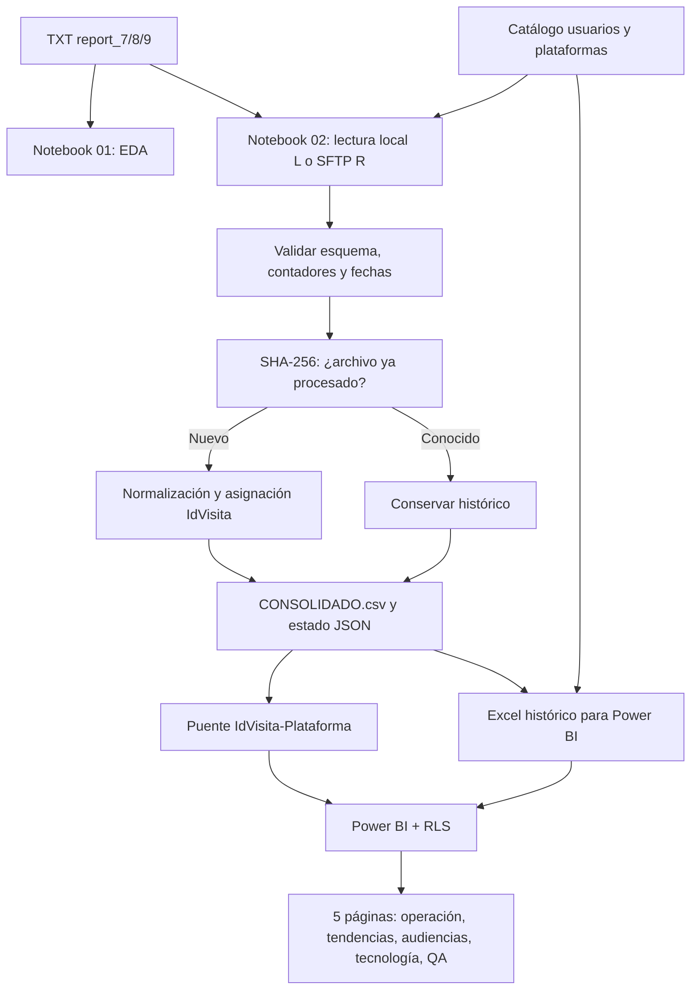

# Arquitectura end-to-end y trazabilidad del ETL

## Contrato de fuentes
Los tres `report_N.txt` se ordenan numéricamente y se leen como CSV de 15 campos. El segundo encabezado se homologa a `CampoExtra`. Los tipos se convierten solo después de confirmar el contrato. `Catalogos/usuarios.txt` tiene columnas `Usuario`, `Rol`, `Plataforma`.

## Orden lógico de las operaciones
1. Resolver carpetas de proyecto con `pathlib`.
2. Seleccionar fuente local o remota, sin modificar transformación posterior.
3. Comprobar encabezados y detectar archivos nuevos mediante nombre y hash.
4. Validar contadores enteros no negativos y fechas interpretables.
5. Crear `FechaVisita` y etiqueta de origen según prioridad.
6. Conservar columnas originales y añadir campos analíticos; preservar visitas anteriores.
7. Asignar IDs únicamente a filas nuevas.
8. Construir puente de plataformas y leer catálogo de permisos.
9. Ejecutar aserciones, preparar resultados de salida y manifestar el estado.
10. Persistir CSV, Excel, puente y JSON del estado.

## Contrato de outputs
- `output/CONSOLIDADO.csv`: histórico de visitas, 26 campos, `IdVisita` estable.
- `output/archivos_procesados.json`: huellas SHA-256 para evitar reproceso.
- `output/Modelo_Integracion_Reporting.xlsx`: hojas `CONSOLIDADO` y `usuarios`.
- `output/Interacciones_Plataforma.xlsx`: hoja `VisitaPlataforma`.
- `powerbi/Caso_Integracion_Reporting.pbip`: definición del modelo, 27 medidas, cinco páginas y rol RLS.

## Límites de cada tabla
- **FactVisitas**: visitas únicas por `IdVisita`; sus recuentos no se reemplazan por `Opens`.
- **DimFecha**: calendario para tendencia y comparaciones, sujeto a período de la muestra.
- **Usuarios**: autorizaciones ficticias de plataforma; no equivale a tabla de visitantes.
- **VisitaPlataforma**: puente para asociaciones, una visita puede tener varios registros.
- **Medidas**: definiciones DAX reutilizables.

## Configuración de fuentes y rutas
Los notebooks de análisis y ETL utilizan rutas relativas a la raíz del proyecto. `03_Configurar_Rutas_PowerBI.ipynb` configura los parámetros `pArchivo` y `pArchivoA` con los Excel de `output/`. Si Jupyter se inició fuera del proyecto, se solicita la carpeta principal. Los ejemplos SFTP no se ejecutan en modo `L` y no requieren credenciales para probar el caso.

## Evidencia e idempotencia
Reejecutar sobre el mismo histórico y manifiesto no debe duplicar las 2,001 visitas. Para probar primera carga se debe usar **otra copia del proyecto**, sin `output/`, ya que eliminar solo el consolidado o solo el JSON dejaría el historial inconsistente.
