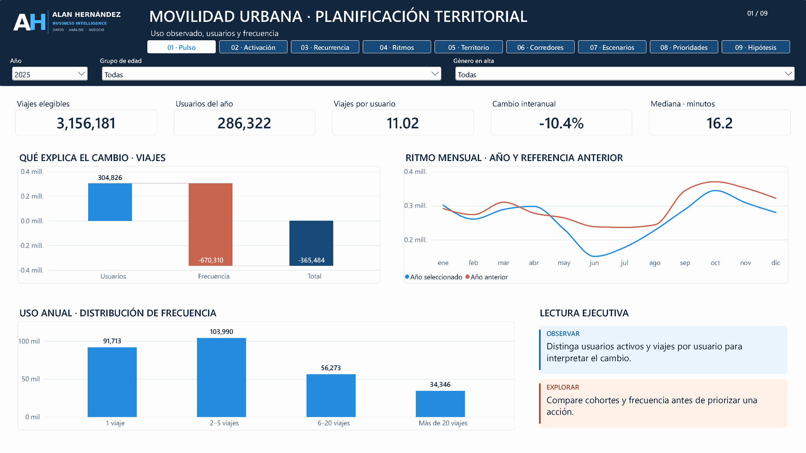

# AH | Movilidad Urbana y Planificación Territorial

**Alan Arturo Hernández Gutiérrez · Business Intelligence**

El caso analiza cómo evoluciona el uso del sistema público de bicicletas de Buenos Aires y qué estaciones, franjas y cohortes conviene priorizar para investigar o diseñar pilotos de vinculación y planificación territorial.

Integra viajes de 2024–2025, altas reales de usuarios y fuentes externas de territorio, infraestructura, calendario y clima. La metodología conecta exploración, reglas de calidad, enriquecimiento geográfico y tablas de consumo para Power BI.

## Hallazgos y valor analítico

- Los usuarios con actividad elegible aumentan de 261,432 a 286,322; los viajes por usuario disminuyen de 13.47 a 11.02.
- La activación a 30 días desde el alta real pasa de 66.86 % a 69.75 %, mientras el retorno observado en otro día a 30 días pasa de 49.34 % a 45.88 %. Cada tasa utiliza su población y ventanas completas.
- Los corredores, perfiles horarios y saldos de movimientos permiten estudiar el papel de las estaciones. La sensibilidad a pesos de volumen, desequilibrio y persistencia permite comparar prioridades de investigación.
- Las ubicaciones observadas permiten analizar territorio sin imponer al pasado la posición de una estación en un catálogo posterior. El contexto incorpora subte, ciclovías y 731 días de ERA5.

El análisis distingue alta real de primera actividad observada. La recurrencia se interpreta por usuario-año. El clima es una estimación de reanálisis y el saldo de movimientos describe entradas y salidas registradas.

## Dashboard

Abrir el [proyecto Power BI](powerbi/Caso_Movilidad_Urbana.pbip) después de ejecutar el [configurador de rutas](notebooks/03_Configurar_Rutas_PowerBI.ipynb). La [guía del dashboard](docs/Guia_Dashboard.md) explica las nueve páginas, poblaciones, filtros y escenarios.

[Ver reporte PDF](reports/Caso_Movilidad_Urbana.pdf) · [Diccionario de KPI y medidas](docs/Diccionario_KPI.md)

## Tablas de consumo

| Archivo en `output/` | Filas | MB |
|---|---:|---:|
| `FactViajes_2024.csv.gz` | 3,559,283 | 81.79 |
| `FactViajes_2025.csv.gz` | 3,156,182 | 78.79 |
| `FactMovimientosEstacion.csv.gz` | 3,657,462 | 14.11 |
| `FactUsuarioAno.csv.gz` | 659,392 | 10.33 |
| `FactContextoDiario.csv` | 731 | 0.10 |
| `DimEstacionUbicacion.csv` | 447 | 0.07 |
| `PuntosCorredor.csv` | 380,600 | 52.26 |

Los CSV comprimidos se leen con Power Query mediante `Binary.Decompress` y `Compression.GZip`. Las particiones anuales de viajes forman una sola tabla lógica. El ETL descubre los años registrados en el manifiesto y admite dividir una anualidad en archivos por límite de filas, sin cambiar el detalle. `output/` contiene únicamente las tablas de consumo.

Las reglas de ventanas, embudo, lluvia y particiones se definen en [config/analisis.json](config/analisis.json). El reporte presenta las 25 mayores conexiones mediante filtros Top N y la medida 83, con el mismo criterio de desempate. El límite visible es una propiedad de presentación: cambiar la configuración del ETL por sí sola no cambia los filtros del PBIP. Los resúmenes auxiliares no sustituyen el detalle de los viajes.

## Reproducción

1. Consultar [fuentes y acceso](data/README.md) y conservar los archivos con los nombres y huellas del manifiesto de fuentes.
2. Iniciar Jupyter desde la raíz del caso o desde `notebooks/`, con las dependencias de `requirements.txt`.
3. Ejecutar [01_exploracion.ipynb](notebooks/01_exploracion.ipynb) para revisar calidad, poblaciones e hipótesis.
4. Ejecutar [02_etl.ipynb](notebooks/02_etl.ipynb) para generar y verificar las siete salidas. La lectura común reside en [src/01_Fuentes.ipynb](src/01_Fuentes.ipynb).

El ETL prepara las tablas en una carpeta temporal, valida su lectura y reemplaza el conjunto completo. La serialización repetida produce las mismas huellas. Las fuentes originales permanecen separadas de las salidas.

## Documentación

- [Análisis, indicadores y reglas](docs/Conclusiones_Exploracion.md).
- [KPI, denominadores e inventario de medidas](docs/Diccionario_KPI.md).
- [Modelo y diccionario de datos](docs/Modelo_y_Datos.md).
- [Ejecución y conciliaciones](docs/Ejecucion_y_Validacion.md).
- [Procedencia, acceso y atribución](data/README.md).
- `MANIFIESTO_SHA256.txt`: integridad de los archivos del caso distribuidos.

`catalogos/` conserva las fuentes externas y el calendario compilado. `input/` contiene los dos ZIP anuales originales, incluidos en la entrega ZIP completa. `powerbi/` contiene el proyecto y su modelo; `reports/` y `assets/` reúnen los documentos y recursos de presentación. Los originales anuales se excluyen únicamente del control de versiones por su tamaño; al trabajar desde Git, se recuperan mediante las URLs y huellas de `catalogos/FUENTES.json`.

La estructura de trabajo contiene `notebooks/` para exploración, ETL y configuración de rutas; `src/` para los cuadernos auxiliares y el código del mapa; `catalogos/` para fuentes complementarias; `output/` para las siete salidas; y `powerbi/`, `reports/` y `assets/` para el informe editable, su PDF y recursos. El modelo utiliza 27 tablas, 17 relaciones y 91 medidas numeradas, incluidas las de formato y presentación.
